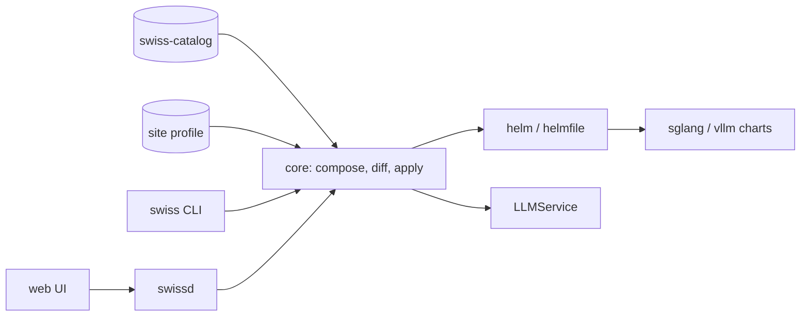
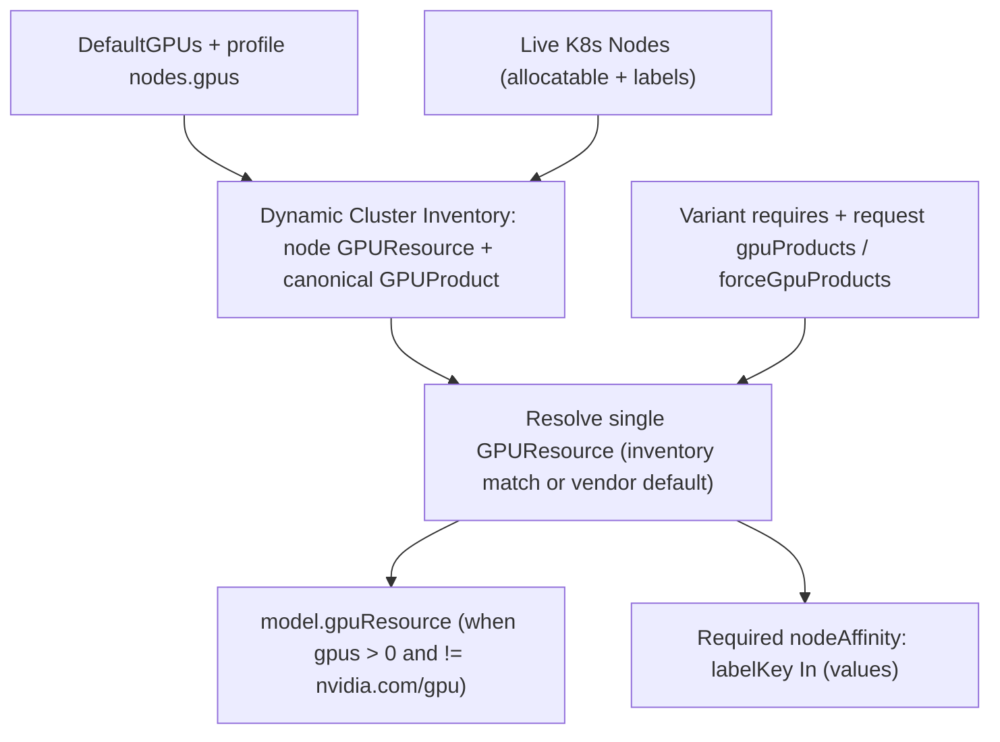

# Swiss architecture

Swiss is a deploy control plane for the sglang and vllm charts. It composes a
model release from a public catalog, a site profile and deploy-time settings,
then hands it to helm. It feeds the existing charts, `helmfile.yaml` and the
`Makefile` targets rather than replacing them.

- **Built:** the catalog, `swiss` (CLI), `swissd` (HTTP server with an embedded
  web UI, write path behind `server.allowDeploy`).
- **Not built:** preflight, `emit`, auth.

## Components

| piece | artifact | runtime |
| --- | --- | --- |
| **swiss-catalog** | published static files, data only | none |
| **core** | Go module, `internal/` | library |
| **`swiss`** | binary | CLI, stateless |
| **`swissd`** | binary | HTTP server |
| **web UI** | React + TypeScript | embedded into `swissd` |

Three things are deployed: the catalog, `swissd`, and the engine charts in the
helm repo (`https://modelsphere.github.io/helm-charts` by default). The catalog
is its own project: [model-catalog](https://github.com/modelsphere/model-catalog).



## Layers

Composition is a few inputs with key sets and strict precedence. Later layer overrides.

| layer | owns |
| --- | --- |
| helm chart defaults | things defaults in sglang/vllm chart values.yaml |
| **site defaults** (`defaults`) | the site's preferences, config it in `defaults.features` in the profile, the `cart`, `serviceMonitor`, `sloRequirement` and `scaler` `enabled` flags, unset on |
| **catalog variant** | model deployment recipes define in [model-catalog](https://github.com/modelsphere/model-catalog) and how it parallelizes: `model.*`, `extraArgs`, `lws.*`, `env`, `image.repository` |
| **site profile** | what makes it work here: the registry mirror, cache paths, route ConfigMaps, namespace, the `model.localPath` template, the default scheduler and priority class |
| **derived** | swiss's rules, above the variant: a section the form filled in is switched on, `cache.maxSlotsPerNode`, `model.gpuResource` and the `requires.gpuProduct` node affinity (see [GPU placement](#gpu-placement)) |
| **user form** | how much, where, how routed: `serviceId`, `replicaCount`, `scaler.*`, `modelRoute.*`, scheduling |
| **plan editor** | the escape hatch, applied last — any key, exempt from ownership, labelled `edit` |

## GPU placement

Placement bridges the catalog's hardware intent (`vendor`, canonical `gpuProduct`, `gpus`) to the cluster's Kubernetes extended resource (`model.gpuResource`) and node label affinity.

### Concepts

| Concept | Source | Role |
| --- | --- | --- |
| Hardware contract | catalog variant `requires` (`vendor`, empty = `nvidia`; `gpuProduct`; `gpus`) | canonical vendor and product names; never carries K8s resource or label names |
| GPU spec table (`gpus`) | built-in `DefaultGPUs` + site profile `nodes.gpus` override | two-level array: Level 1 `(vendor, resource, labelKey)`, Level 2 optional `products` (`product` -> `values`) |
| Dynamic cluster inventory | `/api/nodes` (`Kube.Nodes` + `gpus` table) | scans live nodes via `(vendor, resource, labelKey)` to build available canonical products on the cluster |
| Deploy override | request `gpuProducts` / `forceGpuProducts` | narrows `requires.gpuProduct`, or forces another cluster product on the same resource |

### Two-level `gpus` table

Built-in `DefaultGPUs` defines Level 1 `(vendor, resource, labelKey)` defaults with no static product list; the site profile's `nodes.gpus` merges by `(vendor, resource)` at Level 1 and by `product` at Level 2.

```yaml
nodes:
  gpus:
    # Level 1: per (vendor, resource) with a single node labelKey
    - vendor: nvidia
      resource: nvidia.com/gpu
      labelKey: nvidia.com/gpu.product

    - vendor: ascend
      resource: huawei.com/Ascend910
      labelKey: accelerator/huawei-ascend910
      # Level 2 (addition only when node label values != canonical gpuProduct):
      products:
        - product: Ascend-910B3
          values: [huawei-Ascend910, module-910b-8]

    # Same vendor, different resource name on this cluster:
    - vendor: ascend
      resource: volcano.sh/Ascend910B3
      labelKey: volcano.sh/npu-name
      products:
        - product: Ascend-910B3
          values: [Ascend910B3]
```

| Vendor | Built-in `resource` | Built-in `labelKey` |
| --- | --- | --- |
| `nvidia` | `nvidia.com/gpu` | `nvidia.com/gpu.product` |
| `ascend` | `huawei.com/Ascend910` | `accelerator/huawei-ascend910` |
| `cambricon` | `cambricon.com/mlu` | `cambricon.com/mlu.product` |
| `hygon` | `hygon.com/dcu` | `hygon.com/dcu.product` |
| `amd` | `amd.com/gpu` | `amd.com/gpu.device-id` |

### Workflow



### Rules

1. **Dynamic product discovery**: For each node with `status.allocatable[resource] > 0`, swiss reads `raw := node.labels[labelKey]`. If `raw` matches a configured `products[].values` entry under that `(vendor, resource)`, `node.GPUProduct` is that canonical `product`; otherwise `node.GPUProduct` is `raw` itself.
2. **Resource resolution**: Look up the target products in the dynamic cluster inventory:
   - Nodes carrying the products report 1 resource $\rightarrow$ use that resource.
   - Nodes carrying the products report $\ge 2$ resources $\rightarrow$ refuse (`400`); caller must pass `gpuProducts` under one resource.
   - No node carries the products (or `products` is empty, or nodes unreadable) $\rightarrow$ fall back to the vendor's default resource (first entry for `vendor` in `gpus`).
3. **`model.gpuResource`**: Written to the `derived` layer only when `requires.gpus > 0` and the resolved resource is not `nvidia.com/gpu` (requires chart `vllm >= 0.9.1` or `sglang >= 0.9.29`); yields if catalog or site layer already set `model.gpuResource`.
4. **Node affinity**: Using the resolved `(vendor, resource)` entry, expand each target `product` to its configured `values` (defaulting to `[product]`) and emit one `matchExpressions` rule: `labelKey In (values...)`. Request `gpuProducts` write to the `form` layer; catalog `requires.gpuProduct` writes to the `derived` layer unless catalog or site already set required `nodeSelectorTerms`.
5. **Override guard**: `gpuProducts` narrows within `requires.gpuProduct`; `forceGpuProducts` (or `gpuProducts` when the variant lists none) must exist in the cluster inventory and resolve to the same resource as the variant's own hardware.
6. **Out of scope**: Tolerations are not derived here.

## Pipeline

```
catalog entry ─┐
site profile  ─┼─► compose ─► Plan ─► diff ─► apply | install ─► helm
form / flags  ─┘             (hash)     ↓
                                   revision lock
```

`applyWith` on the site profile picks the backend for a new install: `helm` (default) or `llmsvc` (LLMService). A release already in the cluster stays on the backend that owns it.

| endpoint | |
| --- | --- |
| `POST /api/plans` | compose; returns the plan and stores it by hash |
| `POST /api/diff` | diff a stored plan against the live release |
| `POST /api/apply` | upgrade, asserting the diffed revision when one is supplied |
| `POST /api/install` | create |
| `DELETE /api/releases/{ns}/{release}` | uninstall |
| `POST /api/releases/{ns}/{release}/chat` | health check: one real inference request |
| `GET /api/runs`, `GET /api/runs/{id}` | the operation log; output is per row, not in the list |
| `GET /api/nodes` | the GPU inventory: type, allocatable, in use, and what holds it |
| `GET /api/profile` | the site profile as parsed, after defaults |
| `GET /api/autoscaling`, `GET /api/releases/{ns}/{release}/autoscaling` | the autoscale loop's last pass per PD release with the form SLO on; in memory only, lost on restart |
