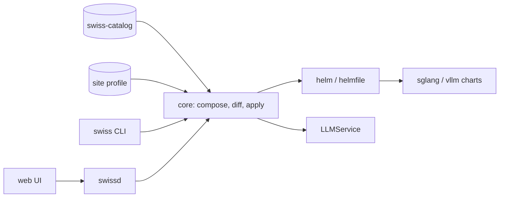
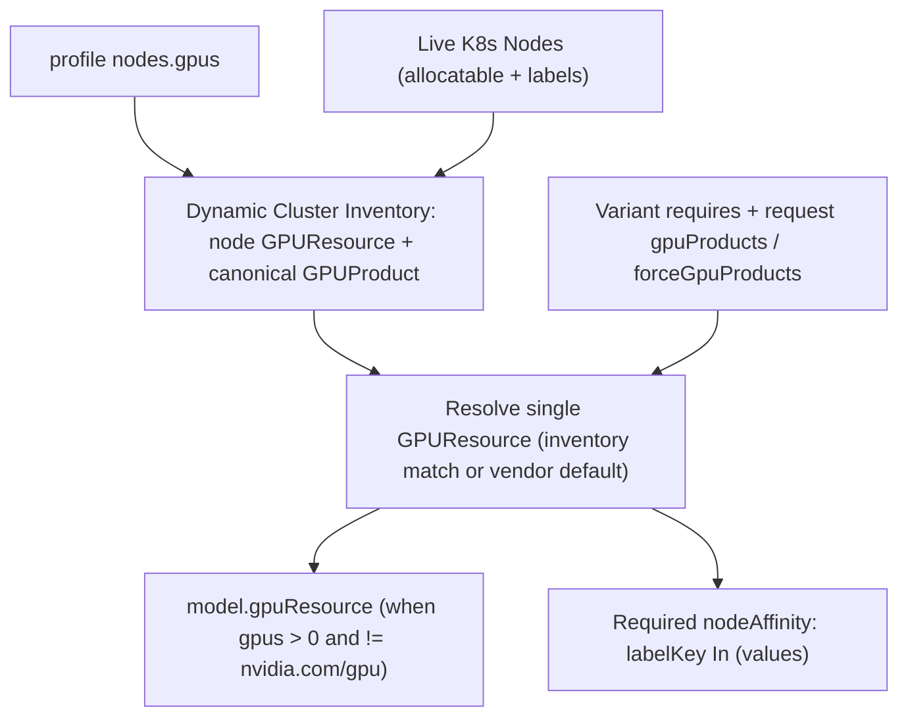

# Swiss architecture

Swiss is a deploy control plane for the sglang and vllm charts. It composes a
model release from a public catalog, a site profile and deploy-time settings,
then hands it to helm. It feeds the existing charts, `helmfile.yaml` and the
`Makefile` targets rather than replacing them.

- **Built:** the catalog, `swiss` (CLI), `swissd` (HTTP server with an embedded
  web UI, write path behind `server.allowDeploy`).
- **Not built:** preflight, `emit`, auth.

## Components

| piece | artifact | runtime |
| --- | --- | --- |
| **swiss-catalog** | published static files, data only | none |
| **core** | Go module, `internal/` | library |
| **`swiss`** | binary | CLI, stateless |
| **`swissd`** | binary | HTTP server |
| **web UI** | React + TypeScript | embedded into `swissd` |

Three things are deployed: the catalog, `swissd`, and the engine charts in the
helm repo (`https://modelsphere.github.io/helm-charts` by default). The catalog
is its own project: [model-catalog](https://github.com/modelsphere/model-catalog).



## Layers

Composition is a few inputs with key sets and strict precedence. Later layer overrides.

| layer | owns |
| --- | --- |
| helm chart defaults | things defaults in sglang/vllm chart values.yaml |
| **site defaults** (`defaults`) | the site's preferences, config it in `defaults.features` in the profile, the `cart`, `serviceMonitor`, `sloRequirement` and `scaler` `enabled` flags, unset on |
| **catalog variant** | model deployment recipes define in [model-catalog](https://github.com/modelsphere/model-catalog) and how it parallelizes: `model.*`, `extraArgs`, `lws.*`, `env`, `image.repository` |
| **site profile** | what makes it work here: the registry mirror, cache paths, route ConfigMaps, namespace, the `model.localPath` template, the default scheduler and priority class |
| **derived** | swiss's rules, above the variant: a section the form filled in is switched on, `cache.maxSlotsPerNode`, `model.gpuResource` and the `requires.gpuProduct` node affinity (see [GPU placement](#gpu-placement)) |
| **user form** | how much, where, how routed: `serviceId`, `replicaCount`, `scaler.*`, `modelRoute.*`, scheduling |
| **plan editor** | the escape hatch, applied last — any key, exempt from ownership, labelled `edit` |

## Site profile

The site profile layer above, as one YAML document swissd owns.

- Stored in a ConfigMap (`cluster.profile.configMap`, the in-cluster case) or a file (`cluster.profile.file`); swissd writes the ConfigMap, never the file.
- Saved through `PUT /api/profile` and parsed strictly: a profile that does not parse is refused, not stored.

### Migration

swissd migrates the stored profile once, when it starts: each step fills in a field a profile from before it lacks. Today there is one step.

- A changed profile is written back, comments kept.
- A profile from a file, or one swissd cannot write, is not migrated: swissd logs the migrated profile to save by hand.

#### `nodes.gpus`

A profile from before `nodes.gpus` gets it once, when swissd starts. New profiles start from the same entries.

| `nodes.gpus` at start | swissd |
| --- | --- |
| missing or `null` | adds the entries below |
| anything else (`[]`, `{}`, wrong type, bad entry) | leaves it; an invalid value is an error until fixed by hand |


Default values supplied:
```yaml
nodes:
  gpus:
    - vendor: nvidia
      resource: nvidia.com/gpu
      labelKey: nvidia.com/gpu.product
    - vendor: ascend
      resource: huawei.com/Ascend910
      labelKey: accelerator/huawei-ascend910
    - vendor: ascend
      resource: volcano.sh/Ascend910B4-1
      labelKey: volcano.sh/npu-name
      products:
        - product: Ascend-910B4
          values: [Ascend910B4-1]
    - vendor: cambricon
      resource: cambricon.com/mlu
      labelKey: cambricon.com/mlu.product
    - vendor: hygon
      resource: hygon.com/dcu
      labelKey: hygon.com/dcu.product
    - vendor: amd
      resource: amd.com/gpu
      labelKey: amd.com/gpu.device-id
```

## GPU placement

Placement bridges the catalog's hardware intent (`vendor`, canonical `gpuProduct`, `gpus`) to the cluster's Kubernetes extended resource (`model.gpuResource`) and node label affinity.

### Concepts

| Concept | Source | Role |
| --- | --- | --- |
| Hardware contract | catalog variant `requires` (`vendor`, empty = `nvidia`; `gpuProduct`; `gpus`) | canonical vendor and product names; never carries K8s resource or label names |
| GPU spec table (`gpus`) | site profile `nodes.gpus`, required | two-level array: Level 1 `(vendor, resource, labelKey)`, Level 2 optional `products` (`product` + extra label `values`) |
| Dynamic cluster inventory | `/api/nodes` (`Kube.Nodes` + `gpus` table) | scans live nodes via `(vendor, resource, labelKey)` to build available canonical products on the cluster |
| Deploy override | request `gpuProducts` / `forceGpuProducts` | narrows `requires.gpuProduct`, or forces another cluster product on the same resource |

### Two-level `gpus` table

The site profile's `nodes.gpus` is the only GPU table; swiss has no defaults of its own.

- A vendor's first entry is its default resource.
- `vendor`, `resource` and `labelKey` are required; a resource is listed once, and a label value names one product under it.
- `[]` is a site without GPU resources. A catalog vendor the table does not list is refused at plan time.
- The old `server.gpuProductLabels` and `nodes.gpuProductAliases` are read and ignored, with a warning.
- A profile from before `nodes.gpus` gets it by [migration](#migration).

```yaml
nodes:
  gpus:
    # Level 1: per (vendor, resource); labelKey is the node label that tells SKUs apart under that resource
    - vendor: nvidia
      resource: nvidia.com/gpu
      labelKey: nvidia.com/gpu.product

    - vendor: ascend
      resource: huawei.com/Ascend910
      labelKey: accelerator/huawei-ascend910
      # Level 2 (only when nodes label a product by another name): extra values that also mean `product`
      products:
        - product: Ascend-910B3
          values: [module-910b-8]

    # Same vendor, different resource name on this cluster:
    - vendor: ascend
      resource: volcano.sh/Ascend910B3
      labelKey: volcano.sh/npu-name
      products:
        - product: Ascend-910B3
          values: [Ascend910B3]
```

### Workflow



### Out of scope

- Tolerations are not derived here.
- Extra node affinity from the deploy request, beyond the product pin, is future work.

## Pipeline

```
catalog entry ─┐
site profile  ─┼─► compose ─► Plan ─► diff ─► apply | install ─► helm
form / flags  ─┘             (hash)     ↓
                                   revision lock
```

`applyWith` on the site profile picks the backend for a new install: `helm` (default) or `llmsvc` (LLMService). A release already in the cluster stays on the backend that owns it.

| endpoint | |
| --- | --- |
| `POST /api/plans` | compose; returns the plan and stores it by hash |
| `POST /api/diff` | diff a stored plan against the live release |
| `POST /api/apply` | upgrade, asserting the diffed revision when one is supplied |
| `POST /api/install` | create |
| `DELETE /api/releases/{ns}/{release}` | uninstall |
| `POST /api/releases/{ns}/{release}/chat` | health check: one real inference request |
| `GET /api/runs`, `GET /api/runs/{id}` | the operation log; output is per row, not in the list |
| `GET /api/nodes` | the GPU inventory: type, allocatable, in use, and what holds it |
| `GET /api/profile` | the site profile as parsed, after defaults |
| `GET /api/autoscaling`, `GET /api/releases/{ns}/{release}/autoscaling` | the autoscale loop's last pass per PD release with the form SLO on; in memory only, lost on restart |

### Complete user configuration

`userValues` on plan and dry-run compose requests represents one complete user document; see [the API design](design/user-values.md).

| Boundary | Behavior |
|---|---|
| Capability | `/api/cluster` advertises `capabilities.userValues` |
| User layers | Replace retained form/edit settings; preserve release identity and explicitly supplied request metadata |
| Clearing | `{}` removes previous user settings and inherits the target baseline |
| System layers | Upgrade composition carries autoscale and canary-system; their precedence remains authoritative |
| Autoscale opt-in | Read the explicit form/edit SLO choice together; catalog/site defaults alone do not opt a release in |
| Validation | Refuse ambiguous legacy inputs, service identity changes and a fixed replica count alongside an enabled scaler |
| Compatibility | Requests omitting `userValues` keep the legacy merge behavior |
