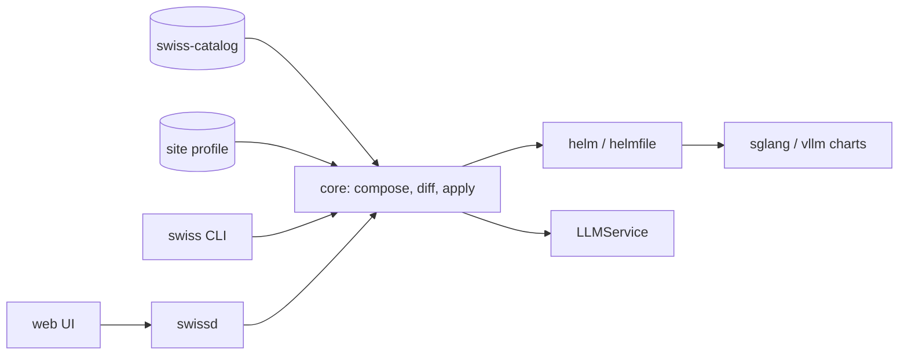

# Swiss architecture

Swiss is a deploy control plane for the sglang and vllm charts. It composes a
model release from a public catalog, a site profile and deploy-time settings,
then hands it to helm. It feeds the existing charts, `helmfile.yaml` and the
`Makefile` targets rather than replacing them.

- **Built:** the catalog, `swiss` (CLI), `swissd` (HTTP server with an embedded
  web UI, write path behind `server.allowDeploy`).
- **Not built:** preflight, `emit`, auth.

## Components

| piece | artifact | runtime |
| --- | --- | --- |
| **swiss-catalog** | published static files, data only | none |
| **core** | Go module, `internal/` | library |
| **`swiss`** | binary | CLI, stateless |
| **`swissd`** | binary | HTTP server |
| **web UI** | React + TypeScript | embedded into `swissd` |

Three things are deployed: the catalog, `swissd`, and the engine charts in the
helm repo (`https://modelsphere.github.io/helm-charts` by default). The catalog
is its own project: [model-catalog](https://github.com/modelsphere/model-catalog).



## Layers

Composition is a few inputs with key sets and strict precedence. Later layer overrides.

| layer | owns |
| --- | --- |
| helm chart defaults | things defaults in sglang/vllm chart values.yaml |
| **site defaults** (`defaults`) | the site's preferences, config it in `defaults.features` in the profile, the `cart`, `serviceMonitor`, `sloRequirement` and `scaler` `enabled` flags, unset on |
| **catalog variant** | model deployment recipes define in [model-catalog](https://github.com/modelsphere/model-catalog) and how it parallelizes: `model.*`, `extraArgs`, `lws.*`, `env`, `image.repository` |
| **site profile** | what makes it work here: the registry mirror, cache paths, route ConfigMaps, namespace, the `model.localPath` template, the default scheduler and priority class |
| **derived** | swiss's rules, above the variant: a section the form filled in is switched on, `cache.maxSlotsPerNode` |
| **user form** | how much, where, how routed: `serviceId`, `replicaCount`, `scaler.*`, `modelRoute.*`, scheduling |
| **plan editor** | the escape hatch, applied last — any key, exempt from ownership, labelled `edit` |

## Pipeline

```
catalog entry ─┐
site profile  ─┼─► compose ─► Plan ─► diff ─► apply | install ─► helm
form / flags  ─┘             (hash)     ↓
                                   revision lock
```

`applyWith` on the site profile picks the backend for a new install: `helm` (default) or `llmsvc` (LLMService). A release already in the cluster stays on the backend that owns it.

| endpoint | |
| --- | --- |
| `POST /api/plans` | compose; returns the plan and stores it by hash |
| `POST /api/diff` | diff a stored plan against the live release |
| `POST /api/apply` | upgrade, asserting the diffed revision when one is supplied |
| `POST /api/install` | create |
| `DELETE /api/releases/{ns}/{release}` | uninstall |
| `POST /api/releases/{ns}/{release}/chat` | health check: one real inference request |
| `GET /api/runs`, `GET /api/runs/{id}` | the operation log; output is per row, not in the list |
| `GET /api/nodes` | the GPU inventory: type, allocatable, in use, and what holds it |
| `GET /api/profile` | the site profile as parsed, after defaults |
| `GET /api/autoscaling`, `GET /api/releases/{ns}/{release}/autoscaling` | the autoscale loop's last pass per PD release with the form SLO on; in memory only, lost on restart |
